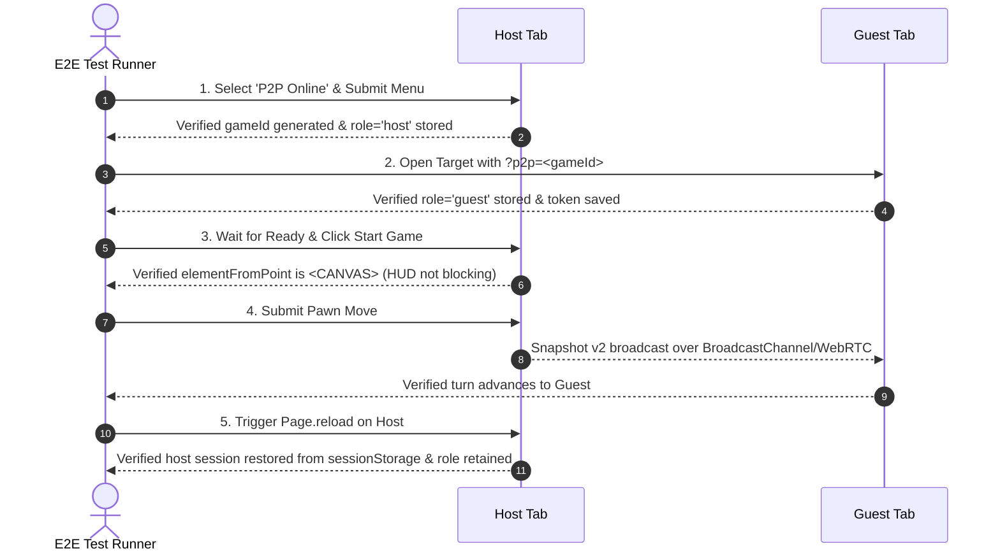

# Quoridors Peer-to-Peer (P2P) Architecture

This document details the serverless Peer-to-Peer (P2P) multiplayer architecture and the automated end-to-end (E2E) testing suite for **Quoridors**.

---

## 1. System Architecture & Network Topology

Quoridors P2P enables decentralized, zero-backend multiplayer directly between browsers using **WebRTC** and same-origin **BroadcastChannel** signaling.

```mermaid
graph TD
    subgraph Host Browser [Host Tab (Seat 0 - Fox)]
        HA[Host UI / BoardScene] --> HC[P2PController]
        HC --> HS[Authoritative Session Engine]
        HS --> HSS[(sessionStorage: host_session)]
        HC --> HBC[BroadcastChannel]
        HC --> HWC[Trystero WebRTC Room]
    end

    subgraph Guest Browser [Guest Tab (Seat 1 - Wolf)]
        GA[Guest UI / BoardScene] --> GC[P2PController]
        GC --> GSS[(sessionStorage: token)]
        GC --> GBC[BroadcastChannel]
        GC --> GWC[Trystero WebRTC Room]
    end

    HBC <-->|Same Origin / Multi-Tab (<1ms)| GBC
    HWC <-->|Nostr Signaling + STUN/TURN (Global WAN)| GWC
```

### 1.1 Host-Authoritative Architecture
- **Single Source of Truth**: The host's browser instantiates and owns the pure algorithmic [`Session`](file:///Users/vm/WebstormProjects/quoridors/game/src/game/session.ts) engine. All rules, legal move checks, wall counts, timers, AI moves, and undo votes are evaluated strictly on the host.
- **Seat Assignment**: Seat `0` is permanently reserved for the host. Seats `1` through `3` are open for guest peers or AI players.
- **Client Tokens**: On seat assignment, the session engine generates a secret `token` for each player (`sessionStorage.getItem('quoridors.p2p.token.<gameId>')`). Guests attach this token in message envelopes (`ClientMsgEnvelope.token`) so the host can authenticate reconnecting peers even if ephemeral WebRTC peer IDs change.

### 1.2 Dual-Transport Layer
1. **Local `BroadcastChannel`** (`quoridors_p2p_<gameId>`):
   - Active for tabs sharing the same origin on the same machine.
   - Provides sub-millisecond, zero-network pairing during local pass-and-play testing, split-screen games, and automated test runners.
2. **Decentralized WebRTC Mesh** (`@trystero-p2p/nostr`):
   - Uses redundant Nostr relay endpoints (`wss://nos.lol`, `wss://nostr.mom`, `wss://relay.primal.net`, `wss://purplerelay.com`) for peer discovery and SDP offer/answer exchange.
   - Uses public STUN/TURN fallbacks (`openrelay.metered.ca`, Google STUN) to traverse NATs and restrictive firewalls without any proprietary game backend.

### 1.3 State Synchronization & Snapshot Reconciliation
- The host periodically or reactively broadcasts immutable `SessionView` snapshots (`{ phase, version, seats, state, event, undo }`).
- Clients maintain a monotonic `version` counter:
  - If incoming `v.version === this.version`: Only seat states (connection indicators) are reconciled; no board re-render occurs.
  - If `v.version === this.version + 1` with an action event: Incremental animations (`animateMove` or `animateWall`) play smoothly.
  - If `this.version < 0` (initial connection or hard refresh): Full board reset (`onUpdate({ type: 'reset' })`) syncs the 3D meshes to the snapshot.

---

## 2. Reusable Automated E2E Testing Suite

To ensure regressions never slip through, the test suite is committed to the repository at [`game/e2e/p2p.e2e.mjs`](file:///Users/vm/WebstormProjects/quoridors/game/e2e/p2p.e2e.mjs) and registered in `package.json`.

### 2.1 Running the Tests

Ensure the preview or dev server is running, then execute:

```bash
cd game
npm run test:e2e
```

### 2.2 Lifecycle Phases Covered by the Test Suite



### 2.3 Test Summary
- **Zero External Test Framework Overhead**: Built with native Node.js and Chrome DevTools Protocol (`--remote-debugging-port`).
- **Headless & CI-Ready**: Automatically detects Chrome/Chromium binaries across macOS, Linux, and Windows.
- **Full Trace Visibility**: Captures console logs, uncaught exceptions, and DOM hit-testing.
