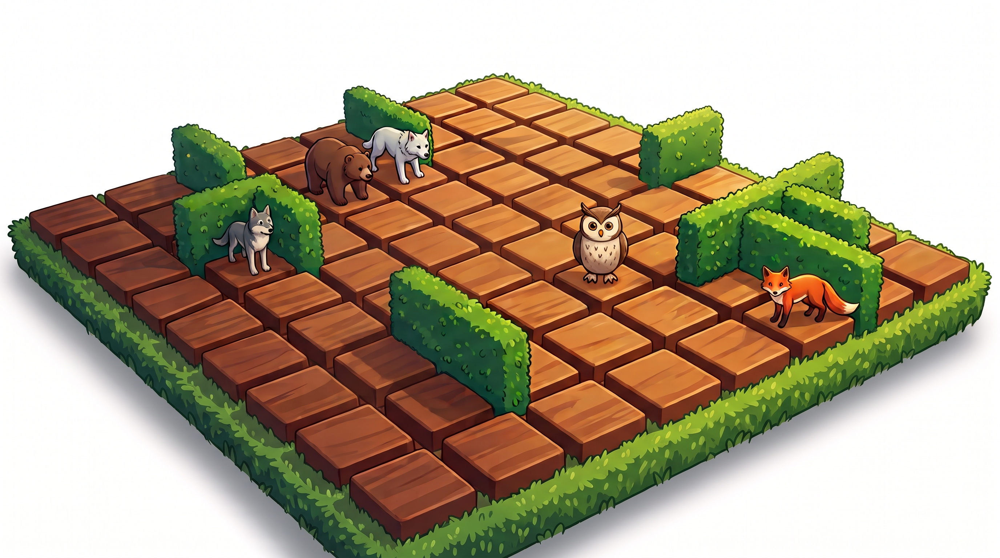

# Quoridors

A 3D web implementation of the board game **Quoridor**, using Three.js, TypeScript, and assets authored in Blender.



---

## Architecture

The project consists of two parts:

1. **Blender Asset Pipeline (`/`)**: A Python script (`build_quoridor_board.py`) that proceduralizes the board, terrain, tiles, hedge walls (via Geometry Nodes), and 5 animal pawn models. It exports `quoridor_board.blend` and `quoridor_board.glb`.
2. **Web Application (`/game`)**: Built with Three.js, TypeScript, and Vite. Includes a rules engine, BFS-based pathfinding, minimax AI, and a glassmorphism HUD.
3. **Unit Tests**: Test suite in Vitest covering rules, jump mechanics, anti-trap invariants, and AI logic with >99% line coverage.

---

## Directory Structure

```
quoridors/
├── build_quoridor_board.py      # Blender 4.4 scene generator
├── quoridor_board.blend         # Blender source file
├── quoridor_board.glb           # Exported GLTF 2.0 binary asset
├── quoridors_design.jpeg        # Design reference
├── textures/                    # Seamless PBR textures
│   ├── wood_tile_texture.jpg    # Tile wood grain
│   ├── lawn_grass_texture.jpg   # Meadow grass texture
│   └── hedge_leaf_texture.jpg   # Hedge foliage texture
├── game/                        # Web application
│   ├── index.html               # Main HTML document
│   ├── package.json
│   ├── tsconfig.json            # Strict TypeScript configuration
│   ├── vite.config.ts           # Bundler configuration
│   └── src/
│       ├── main.ts              # Game loop, input handling, turn management
│       ├── style.css            # Styles and design tokens
│       ├── game/
│       │   ├── rules.ts         # Core rules engine (headless, no rendering dependencies)
│       │   ├── ai.ts            # Heuristic AI and alpha-beta search
│       │   ├── animals.ts       # Character definitions
│       │   └── __tests__/       # Vitest unit test suites
│       │       ├── rules.test.ts
│       │       └── ai.test.ts
│       ├── scene/
│       │   ├── BoardScene.ts    # Three.js scene, lighting, triplanar UVs, raycasting
│       │   └── tween.ts         # Animation tween helper
│       └── ui/
│           └── Hud.ts           # HUD and dialog management
├── README.md
└── AGENTS.md                    # Developer guidelines for AI coding agents
```

---

## Getting Started

### Prerequisites

- Node.js 18+
- npm 9+
- Blender 4.4+ (optional, only required to rebuild 3D models)

### Web Application

```bash
cd game
npm install
npm run dev
```

The application runs at `http://localhost:5173/`.

### Tests

```bash
cd game
npm test
```

To run with coverage reporting:

```bash
npm test -- --coverage
```

### Automated P2P E2E Tests

To run the automated multi-tab headless Chrome E2E test suite (verifying P2P pairing, canvas hit-testing, and host reload recovery):

```bash
cd game
npm run test:e2e
```

For full networking specifications and E2E test lifecycle, see [`P2P_ARCHITECTURE.md`](file:///Users/vm/WebstormProjects/quoridors/P2P_ARCHITECTURE.md).

### Production Build

```bash
cd game
npm run build
npm run preview
```

---

## 3D Asset Pipeline

To rebuild the Blender scene and export the GLB asset:

```bash
/Applications/Blender.app/Contents/MacOS/Blender -b -P build_quoridor_board.py
```

### Export Notes
The GLTF export must specify `export_apply=True` to bake Geometry Nodes modifiers on hedge walls into final mesh geometry.

---

## Game Rules & Controls

### Rules
- **Objective**: Be the first player to reach the opposite row or column of the board.
- **Turn Actions**: Either move your pawn one square orthogonally, or place a hedge wall.
- **Jumps**:
  - When facing an adjacent pawn with an open space behind it, you may jump straight over.
  - If a wall or board edge blocks the straight jump, you may jump diagonally to either side.
- **Walls**:
  - Walls occupy two groove segments.
  - Walls cannot overlap or intersect.
  - Anti-trap rule: A wall cannot be placed if it completely seals off any player from reaching their goal line.
  - 10 walls per player in 2-player games, 5 walls in 4-player games.

### Controls
- **Click**: Select an highlighted tile to move, or click a groove to place a wall.
- **Hover**: Preview wall placement and validity (green = valid, red = blocked/invalid).
- **Orbit**: Click and drag on empty space to rotate the camera; scroll to zoom.
- **Shortcuts**:
  - `Z`: Undo move
  - `C`: Reset camera behind active player
  - `Esc`: Open setup menu
